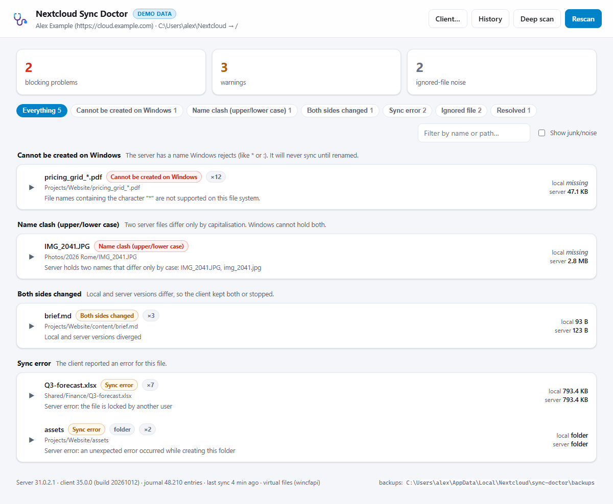
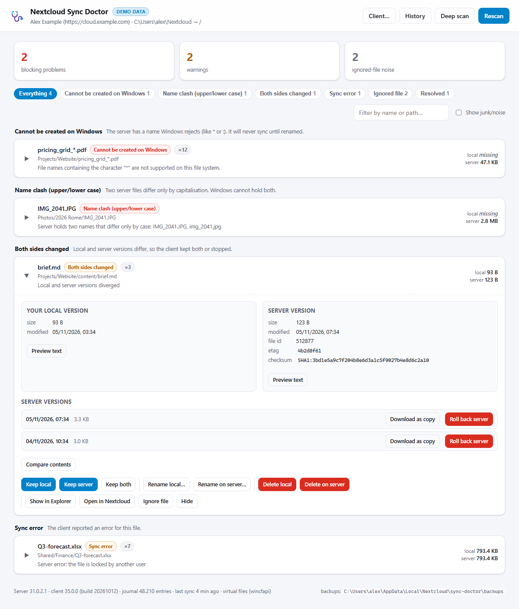
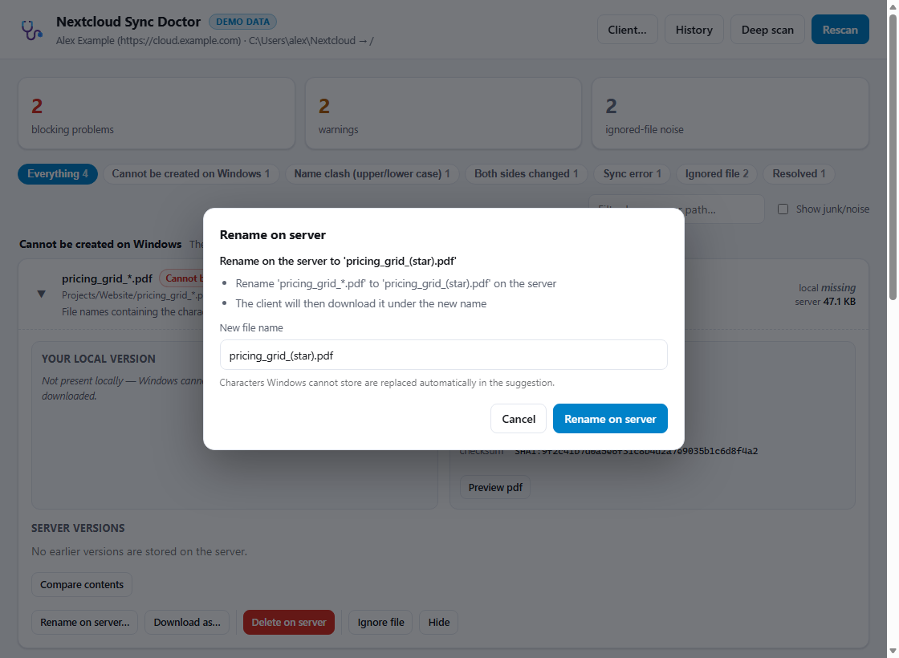
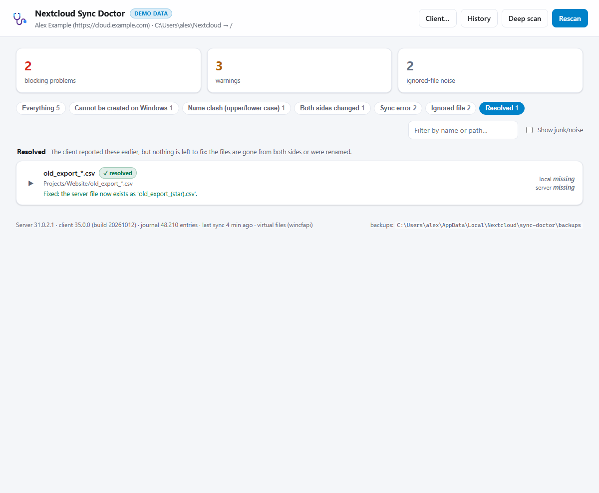
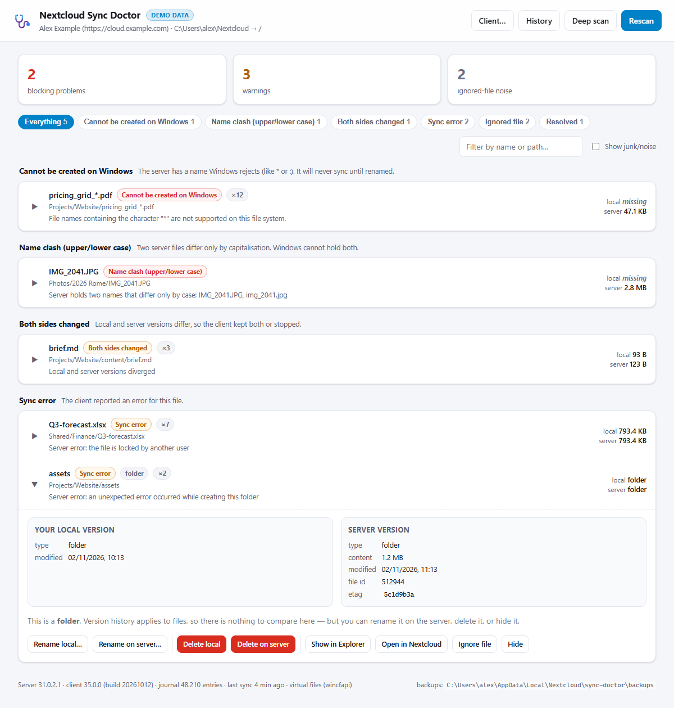
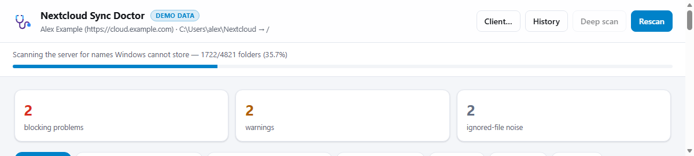

# Nextcloud Sync Doctor

[](https://github.com/frischeDaten/nextcloud-sync-doctor/actions/workflows/ci.yml)
[](LICENSE)

A per-file sync problem resolver for the Nextcloud Desktop Client on **Windows and
macOS**.

The client tells you *"Some files could not be synced!"* and sends you to an activity
list. That list is not filtered, has no per-file resolution for anything that is not a
textbook conflict, is not persisted, and cannot show you what the server actually has.
For one whole class of failures — names created on macOS that Windows cannot store — no
GUI action helps at all, because the file cannot exist locally. On a Mac the same tool
also covers the failures that only exist there: Finder deletions that pile up in a local
`.Trash` folder, cloud placeholders that were never downloaded, and a FileProvider sync
folder whose journal the client keeps where nothing else can see it.

This tool reads the client's own data, talks to your server with the client's own
credentials, and gives you a list of the files that are actually broken, with the local
and server version side by side and a decision to make for each one:

* keep the **local** version (upload, overwrite the server copy)
* keep the **server** version (download, overwrite the local copy)
* keep **both** (your file moves aside under a new name, the server version comes in)
* **rename** it on the server so Windows can store it at all (also useful on a Mac that
  shares the folder with Windows machines)
* **roll back** to an earlier server version, or pull one out as a copy
* **delete** one side (server deletes go to the trash)
* **ignore** it forever, or just hide the entry

Every destructive step is backed up locally and logged.







All screenshots come from demo mode (`--demo`) with fictional accounts and files — no real
hostnames, user names or paths.

## Install

Requires **Python 3.10 or newer**. The launchers find a suitable interpreter themselves
(`py`/`python`/`python3` on Windows, `python3.10`–`python3.13`/`python3` on macOS).

**No Git needed — use the ZIP.** Download the ZIP for your system from the
[latest release](https://github.com/frischeDaten/nextcloud-sync-doctor/releases/latest) —
`nextcloud-sync-doctor-<version>.zip` for Windows or
`nextcloud-sync-doctor-<version>-macos.zip` for macOS. Unpack it anywhere (it contains a
single folder) and start the launcher for your system:

| System | Launcher |
|---|---|
| Windows | double-click **`Nextcloud Sync Doctor.cmd`** (SmartScreen: *More info → Run anyway*) |
| macOS | double-click **`Nextcloud Sync Doctor.command`** (if Finder refuses it: right-click → *Open*) |

Both ZIPs contain the same program; only the launcher and its executable permission
differ. The archive is byte-reproducible, so either ZIP can be rebuilt and verified.

**From a checkout:** run the same launcher in the repository folder.

Either way:

1. Make sure the Nextcloud desktop client has run at least once for the account.
2. Start the launcher.
3. A console window opens with a URL containing a security token; the browser opens
   automatically. Keep the console open while you work.
4. Press **Rescan**. Fix things. Press **Rescan** again (or restart the client from the
   **Client…** button) to watch the list empty out.

### macOS: Full Disk Access

Since version 3.7 the macOS client is a **sandboxed app** and keeps its settings, its log
and its sync journal inside
`~/Library/Containers/com.nextcloud.desktopclient/Data`. macOS does not let other programs
read that folder. So the doctor needs one of these:

* **Full Disk Access** for the app you start it from (Terminal, iTerm, …):
  *System Settings → Privacy & Security → Full Disk Access*, add the app, quit and reopen
  it. Then the doctor reads the client's own configuration, log and journal like on Windows.
* or **`--config`** pointing at a readable copy of `nextcloud.cfg`
  (`./"Nextcloud Sync Doctor.command" --config ~/nextcloud.cfg`), plus **`--password`** for
  the app password. Without the journal the doctor still works from the log and a deep
  server scan.

The launcher checks this before starting and explains it if the configuration is
unreadable. The doctor itself never asks macOS to change permissions: when it cannot read
the file it says so instead of failing obscurely.

**As a Python package:**

```bash
pip install -e .            # or: pipx install git+https://github.com/frischeDaten/nextcloud-sync-doctor
ncsd serve
```

**Demo mode** — fictional data, no client, no server, nothing on your machine is read or
changed:

```bash
ncsd --demo serve                    # the UI with sample issues
"Nextcloud Sync Doctor.cmd" --demo   # same, from the ZIP (Windows)
./"Nextcloud Sync Doctor.command" --demo   # same, from the ZIP (macOS)
```

There are no runtime dependencies beyond the Python standard library.

## What it finds

| Class | Meaning | Typical cause |
|---|---|---|
| **Cannot be created on Windows** | Server name uses `* ? < > " \| :` , a reserved device name (`CON`, `AUX`, `LPT1`…), a trailing dot/space, or is longer than 254 chars | A file created on macOS, Linux or in the web UI |
| **Name clash (upper/lower case)** | Two server files differ only by capitalisation | `Report.pdf` and `report.pdf` from different machines |
| **Both sides changed** | The client kept a conflicted copy | Editing the same file offline on two machines |
| **Sync error** | Any other failure the client reported (permissions, locks, storage, IO) | Revoked share, full quota, file locked |
| **Path too long for Windows** | Full local path beyond the classic 259 chars | Deep folder trees; Explorer and most apps fail, the client copes |
| **Ignored file** | Excluded by the client's ignore list but *reported as a sync error* | The 2026 regression that floods the activity list |
| **Leftover in Finder trash** *(macOS)* | The item sits in the folder's local `.Trash` folder; the server copy is usually already gone | Deleted in Finder on a FileProvider folder — the provider moves it aside instead of removing it |
| **Conflict copy** | A `name (conflicted copy …)` file the client made on purpose | Both sides changed; not an error |
| **macOS / Windows junk** | `._*` resource forks, `.DS_Store` (and `.DS_Store 2`, `.DS_Store 3`… copies FileProvider leaves behind), `Thumbs.db`, `~$*.docx` lock files | Syncing between macOS and Windows |

The first three are real problems. The rest are noise — the client counts them as errors,
which is why an exclamation mark rarely tells you anything.

### What is specific to a Mac

| What the doctor shows | Why it matters on macOS |
|---|---|
| **FileProvider folder** banner | A FileProvider sync folder keeps its journal in a protected system directory, so the classic "journal in the sync folder" does not exist. The banner says so instead of pretending the journal is missing. |
| **Folder found, not configured** | A macOS FileProvider account stores **no folder path at all** in `nextcloud.cfg` — only a domain identifier. The doctor finds the folder in `~/Library/CloudStorage` by its name (`Nextcloud-<server>-<user or display name>`) and says so in the banner. If the name is ambiguous or the folder is missing, it says that instead of guessing. |
| **iCloud Drive** warning | A Nextcloud sync folder inside iCloud Drive is managed by two sync services at once; both rename and re-create files, which produces conflicts neither client can explain. Move the folder out. |
| **"not downloaded (cloud placeholder)"** on the local side | A FileProvider folder keeps content in the cloud until something opens it. That is normal — but a preview *downloads* the file into the sync folder, and the UI says so first. |
| **`.Trash` leftovers** | Finder deletions on a FileProvider volume land in a local `.Trash` folder, and the client reports them as sync errors that can never be fixed from the server side. The action removes the local leftover (backed up first) and the empty `.Trash` with it. |
| **`._*` and numbered `.DS_Store` files** | macOS metadata that Windows cannot represent; counted as junk, hidden unless you switch on *Show junk/noise*. |
| **Unicode-normalised names** | macOS stores names decomposed (NFD) while servers and Windows store them composed (NFC); comparisons and case clashes are normalised first, so a name is not reported as two. |

Windows-invalid names are still flagged **on a Mac**, because a Mac that shares a folder
with Windows machines creates exactly those files.

### It stays honest about what is still broken

Log lines and journal rows describe the **past**. Every scan re-checks the current state,
so an entry leaves the list as soon as it stops being a problem:

* **an older sync run said this, but later runs were clean** → marked **✓ resolved**. The
  client's log records every run; if the folder has synced since without repeating the
  error, the error was transient (a locked file, a retried `MKCOL`, a timeout);
* if neither a local nor a server file exists at that path any more, the entry is resolved
  too; if the server file was renamed to a Windows-safe name, it even says what it is
  called now — `Fixed: the server file now exists as 'pricing_grid_(star).pdf'.`;
* log lines older than seven days are ignored unless the file is still there, so an old
  rotated log cannot resurrect a problem you already fixed;
* **folders are shown as folders.** A directory has no meaningful "size" to compare (the
  server reports the recursive total, Windows reports a directory entry), so the row says
  `folder`, comparison and previews are not offered, and only the actions that make sense
  for a folder remain: rename, delete, open, ignore.





### Where the data comes from

1. **The client's log files** — the only place the client records the errors it shows.
   The activity list itself is memory-only and disappears on restart.
2. **The sync journal** (`.sync_<hash>.db`) — read from a copied snapshot, read-only.
   Its `blacklist` table is the client's own persisted list of failed items, with the
   exact error message; the `conflicts`/`caseconflicts` tables map conflict copies to
   their base file.
3. **A deep server scan** (opt-in) — `PROPFIND` over the folder tree, looking for names
   and paths Windows cannot represent. This finds files the client skipped once and
   then never mentioned again, because they never entered the journal at all.

   

   It costs one request per folder (~50–60 folders/second against a remote server), so it
   only runs when you press the button.

## Actions

| Action | What it does | Safety |
|---|---|---|
| Keep local | Uploads your file over the server copy, preserving the modification time | Previous server version downloaded to the backup folder first |
| Keep server | Writes the server content over your file and sets the server mtime | Your local file is copied to the backup folder first |
| Keep both | Renames your file to `name (local copy <date> <time>).ext`, then brings the server version in | Nothing is destroyed; both files sync |
| Rename on server | `MOVE` on the server to a Windows-safe name (suggested automatically) | Rename back any time; the client then downloads it |
| Rename local / Download as… | Local rename, or pull the server copy in under another name | — |
| Download version as copy | Fetches an older server revision into the sync folder | Server untouched |
| Roll back server | Moves the server revision into Nextcloud's restore endpoint, then downloads it | The server keeps the replaced content as a version |
| Delete on server | `DELETE` (Nextcloud moves it to the trash) | Recoverable from the server trash |
| Delete local | Copies to the backup folder, then removes it locally | Backup + server copy remain |
| Ignore file | Appends a literal path pattern to the folder's `.sync-exclude.lst` | The client never downloads it again |
| Hide | Only hides the row in this tool | Nothing touched |

Notes:
* "Keep both" deliberately does **not** use the client's `(conflicted copy …)` naming:
  the client refuses to upload those by default, so the copy would stay local forever.
* Server-side writes check nothing implicitly — if your share is read-only the request
  fails and the error is shown instead of silently doing nothing.

## Safety model

* The sync journal is **never written**. It is copied (`db` + `wal` + `shm`) and opened
  read-only, so the client can keep running.
* Local overwrites and deletions copy the file to the doctor's backup folder first
  (see [Where things live](#where-things-live)).
* Server overwrites download the current server version to that same backup folder first
  (configurable size limit, default 256 MB).
* Server deletions go through Nextcloud, i.e. into the server trash bin.
* Every applied action is appended to the audit log (`audit.jsonl`) and visible under
  **History** in the UI.
* The UI listens on `127.0.0.1` only and requires the random token from the console URL.
* No password is stored. The tool reads the app password the client already keeps — in the
  Windows Credential Manager (`Nextcloud_<user>_app-password:<url>:<id>`) or in the macOS
  login keychain (service `Nextcloud`, account `<user>_app-password:<url>[:<id>]`). It
  never modifies or deletes that entry. Use `--password` to supply your own app password
  (Nextcloud → Settings → Security → App passwords) and skip the store entirely.

  On macOS the first keychain read asks once for permission; *Always Allow* makes it
  silent afterwards. The doctor lists the stored accounts by reading the keychain's
  (non-secret) attribute table, so finding the right item never prompts — only reading
  the secret does.

## CLI

```
python -m ncsd scan            # human readable report
python -m ncsd scan --json     # machine readable
python -m ncsd scan --junk     # include .DS_Store / ._* noise
python -m ncsd scan --deep     # also crawl the server for Windows-invalid names
python -m ncsd check           # what the doctor can see here, and a local name check
python -m ncsd serve           # the web UI
python -m ncsd report          # audit trail + backup size
```

`ncsd check` answers "is it working, and is anything actually broken?" without the
server: it prints the config it read, the account, the folder (and how it was found), whether
the log, journal and credential are available, then walks the folder and checks every name
against the client's rules. Options: `--all` (include large archive folders),
`--timeout N` (seconds, default 180), `--limit N`.

Global options: `--account N`, `--folder N` (for multi-account setups),
`--password <app-password>`, `--config <nextcloud.cfg>` (or `NCSD_CONFIG`; useful when
macOS hides the client's own copy), and `--demo` to use the synthetic fixtures instead of
your client and server.

## Limitations

* Windows and macOS for real use. The Windows side is the original; the macOS side reuses
  the keychain, reads the sandboxed client's data (with Full Disk Access) and adds the
  macOS-only findings above. Linux is supported for demo mode and the WebDAV half only:
  the credential reuse is not implemented there, so `--password` is required.
* On macOS the sync journal is often unreadable even with the log available (FileProvider
  keeps it in a protected directory). The log and the deep server scan still work; the
  journal's persisted blacklist is the part that is missed.
* A **local** walk of a FileProvider folder costs a provider round-trip per folder (roughly
  0.7–1.3 s on a real account), so a folder with thousands of directories takes a long time
  and a folder with 100k files is not practical. `ncsd check` therefore walks breadth-first,
  skips dependency folders (`venv`, `node_modules`, `.git`, …) and large archive folders
  (`Backup`, `Loswebos Migration`, …) unless `--all` is given, and stops after a time
  limit instead of running for hours. **Deep scan** asks the server instead, which is much
  faster (one request per folder, ~50–60 folders/second) and does not depend on what is
  downloaded locally.
* One account and one sync folder per session.
* A deep scan costs roughly one `PROPFIND` per folder (about 50–60 folders/second against
  a remote server, so a 10k-folder tree takes a few minutes). Scope it if the tree is
  huge. Folders that fail (timeouts, no permission) are retried once and then counted
  under "folder(s) could not be read".
* The tool does not edit the sync journal, so it cannot force the client to re-evaluate a
  blacklisted item immediately. The client picks up changes on its next sync; use
  **Client… → Restart** to force one.
* Actions run while the client is running can race with an in-flight sync. The outcome is
  still consistent (both sides end up with the same content), but re-run **Rescan** to see
  the settled state.
* "Keep server"/"Download" preserve the server mtime so the client sees the file as up to
  date; if the client still uploads it once, the content is identical.

## Where things live

| What | Windows | macOS |
|---|---|---|
| Backups | `%LOCALAPPDATA%\Nextcloud\sync-doctor\backups\` | `~/Library/Application Support/Nextcloud/sync-doctor/backups/` |
| Audit log | `%LOCALAPPDATA%\Nextcloud\sync-doctor\audit.jsonl` | `~/Library/Application Support/Nextcloud/sync-doctor/audit.jsonl` |
| Hidden entries | `%LOCALAPPDATA%\Nextcloud\sync-doctor\dismissals.json` | `~/Library/Application Support/Nextcloud/sync-doctor/dismissals.json` |
| Journal snapshots | `%LOCALAPPDATA%\Nextcloud\sync-doctor\snapshots\` | `~/Library/Application Support/Nextcloud/sync-doctor/snapshots/` |
| Client config read | `%APPDATA%\Nextcloud\nextcloud.cfg` | `~/Library/Containers/com.nextcloud.desktopclient/Data/Library/Preferences/Nextcloud/nextcloud.cfg` (Full Disk Access) |
| Client logs read | `%APPDATA%\Nextcloud\logs\` | `~/Library/Application Support/Nextcloud/` (and the sandbox container's copy) |
| Client credential | Windows Credential Manager | login keychain, service `Nextcloud` |

`NCSD_DATA_DIR` overrides the doctor's data folder on every platform.

## Troubleshooting

* **"No stored Nextcloud credential found"** — the client has never stored an app
  password for this account, or it was invalidated. Add an app password in Nextcloud →
  Settings → Security → App passwords and pass it with `--password`.
* **HTTP 401 / 403 from the server** — the stored token was revoked. Same fix.
* **"Port already in use"** — another instance is already running; use the URL from its
  console window.
* **Nothing found but the client still shows a warning** — that is almost certainly the
  ignored-file regression; switch on **Show junk/noise** to confirm.
* **macOS: "the Nextcloud client's configuration exists but macOS does not let this process
  read it"** — see [Full Disk Access](#macos-full-disk-access). Grant it to the app you
  start the doctor from, or use `--config`/`--password`.
* **macOS: a keychain prompt appears** — macOS asks once before a terminal app may read
  the client's stored app password; choose *Always Allow*. Cancel it and the doctor falls
  back to asking you for `--password`.
* **macOS: the journal is reported unavailable** — normal for a FileProvider folder (see
  [What is specific to a Mac](#what-is-specific-to-a-mac)); the log and deep scan still
  work.
* **"No sync problems found" but you expected some** — the empty page now lists what was
  checked (log, journal, deep scan). Run `ncsd check` to see it from the terminal, and press
  **Deep scan** in the UI to ask the server. A problem that was fixed earlier stays fixed:
  the list only shows what is broken *now*.
* **macOS: "no sync folders configured"** — the client's `nextcloud.cfg` has no
  `Folders\…\localPath` keys, which is normal for a FileProvider account. The doctor
  looks for the folder in `~/Library/CloudStorage`; if it cannot decide, it says which
  name it expected. `bash tools/macos-diagnostics.sh` prints where the client keeps its
  domain data (paths redacted) if you need to dig further.

## Security and privacy

The doctor reads the app password the desktop client already stored — Windows Credential
Manager or macOS login keychain, read-only and never modified — or takes one via
`--password`. The token is kept in memory and only ever sent to your own server. The UI
binds to `127.0.0.1` and requires a random per-run token. No telemetry, no third-party
dependencies.
Details and how to report a vulnerability: [SECURITY.md](SECURITY.md).

## Contributing

Bug reports and pull requests are welcome — see [CONTRIBUTING.md](CONTRIBUTING.md). The
quickest way to work on it is `ncsd --demo serve`, which needs no Nextcloud account.
`python -m unittest discover -s tests` runs the platform tests (no client, keychain or
network needed) on Windows, macOS and Linux.

[docs/upstream-contribution.md](docs/upstream-contribution.md) documents the underlying
desktop-client behaviour (and bugs) this tool works around, together with what a proper
upstream fix would have to touch.

## Changelog

[CHANGELOG.md](CHANGELOG.md) lists what changed in each release.

## License

GPL-2.0-or-later — see [LICENSE](LICENSE). That matches the licence of the Nextcloud
desktop client whose name rules this tool reimplements, and keeps any part of it usable in
an upstream contribution. (If you would rather publish it under MIT, change `LICENSE` and
the `license` field in `pyproject.toml`; nothing in the code depends on the licence.)
